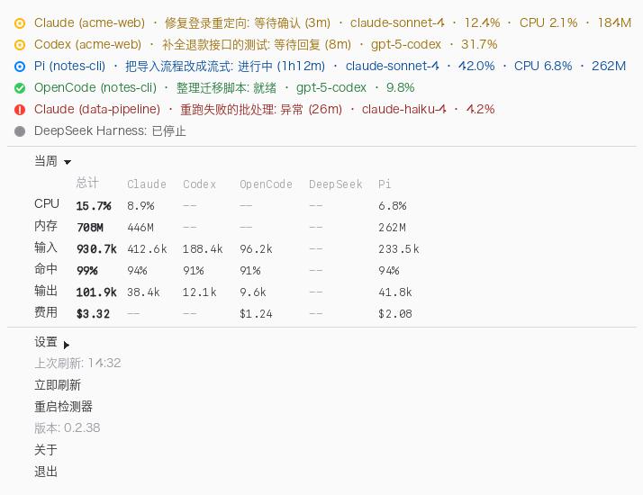
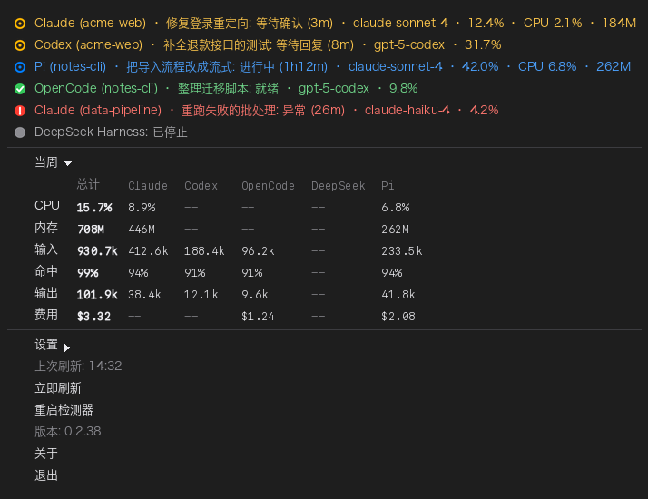
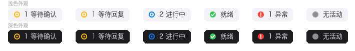

# AgentStatusIndicator

**English** | [中文](README.md) | [Changelog](CHANGELOG.en.md) | [变更日志](CHANGELOG.md)

A native tray monitor for AI coding agents (macOS first, with Windows/Linux support). It watches coding agents such as Claude Code, Codex CLI, OpenCode, DeepSeek Harness and Pi: while a process is alive, sessions are grouped by project, and the tray shows a six-state summary — *waiting for confirmation, waiting for reply, working, ready, error, stopped*. Error, failed, aborted and disconnect signals are surfaced as the error state. Clicking a menu item jumps back to the matching terminal, browser or desktop-application session, and native system notifications fire whenever human attention is needed.

**DeepSeek Harness desktop**: the Electron app hosts every conversation it has open in a single process, so the tray reads the session projection cache of the profile that process runs and lists each live conversation as its own row (title, project, model, context usage). The two signals the projection cache does not carry are read from the session event log: an unanswered confirmation prompt counts as *waiting for confirmation*, and a failed or disconnected turn as *error*; a session with `approval: never` is recognized as auto-confirmation mode and stops repeating its reminders. Waiting and failed conversations are listed first, and beyond eight rows a grey “… N more sessions” row states how many were left out. Clicking any row **opens that conversation**, degrading through the capabilities the machine actually has: (1) the native session route `dsh://session/<id>` — upstream shells answer only `dsh://open` today, so this rung is gated on a release version and ships disabled, while every row already carries that address, and allowing it later is one constant; (2) pressing the conversation's row in the app's own sidebar through the macOS **accessibility** API, confirmed by the window title; (3) only bringing the window forward (`dsh://open`, which restores a minimized window and recreates a closed one). The second rung needs a system grant, so Settings → **DeepSeek Harness** always carries one row for the permission: it reads *needs Accessibility permission, click to grant it* while the grant is missing, and *Open Accessibility Settings* once it exists. The grant is asked for only at the moment the user asks for the feature: launching the tray prompts nothing, and a click on a session row never interrupts itself with a confirmation box. One click, one window: macOS's own prompt is the only thing that writes the app into the Accessibility list and it appears once per signature, so the *first* ask is that prompt alone (its *Open System Settings* button leads to the pane), and every ask after it opens the pane directly. Both the *Session-level jump* switch, when turned on without the grant, and the permission row trigger it. Without the grant, or when the conversation is gone from the sidebar, the click falls back to the third rung. The **session jump** switch pins the third rung when turned off. Everything desktop-related sits under one Settings group, **DeepSeek Harness**: the conversation range (a submenu) that decides how long a finished conversation keeps its row, the session-jump switch, and — only while the grant is missing and the switch is on — the row that asks for it. Every row uses one shape, `Kind (project) · title` (falling back to `Kind (project)` when no title is known, and truncating the title at 24 characters); DeepSeek Harness conversations no longer name a terminal or desktop form — one conversation is always one row, and a click opens whichever of `dsh web` or the desktop window is driving it.

Source and releases: <https://github.com/DuRunzhe/AgentIndicator>

## Screens

### Tray menu

Every row leads with its six-state lamp and takes the lamp's colour; the token table and Settings follow (CPU and memory are off by default and can be turned on under Settings → Display).



The same menu in dark appearance: only the row text is lifted, the icons keep their own colour.



### Menu bar

The menu bar holds a single status item: its icon shows the highest state in play and its text counts the sessions in that state, one state at a time.



> These are not screenshots but renders of the real drawing code; the projects, session titles and figures are examples.

## Installation

The current release is **v0.2.46-alpha.1**: a Developer ID signed and notarized app bundle for macOS arm64, plus binaries for x86_64 macOS, Windows and Linux (both x86_64 and ARM64, the two mainstream architectures) and the npm package, all produced by the [release workflow](.github/workflows/release.yml).

### curl (macOS / Linux)

```bash
curl -fsSL https://raw.githubusercontent.com/DuRunzhe/AgentIndicator/main/scripts/install.sh | sh
```

Without `VERSION` the script automatically resolves the latest release, trying the GitHub API, the `releases/latest` redirect and the npm registry in turn; you only need to pin a version when none of those is reachable. To update, re-run the install command above (it resolves the latest version). On macOS (Apple Silicon) it also downloads the notarized `.app` from the release and installs it into your Applications folder (the `.app` asset ships with releases cut after this workflow change; if a version lacks the asset, the script prints a notice and installs the CLI binary only).

Pin a version:

```bash
curl -fsSL https://raw.githubusercontent.com/DuRunzhe/AgentIndicator/main/scripts/install.sh | VERSION=0.2.46-alpha.1 sh
```

Install elsewhere:

```bash
curl -fsSL https://raw.githubusercontent.com/DuRunzhe/AgentIndicator/main/scripts/install.sh | PREFIX=/usr/local/bin sh
```

#### Adding it to your applications (optional)

- **macOS (Apple Silicon)**: nothing to do. The script automatically downloads the notarized `.app` and installs it into `/Applications` (falling back to `~/Applications` when it is not writable); launch it from Launchpad or with `open -a AgentStatusIndicator` — Gatekeeper will not block it. The CLI binary goes to `${PREFIX:-$HOME/.local}/bin`.
- **macOS (x86_64)**: no notarized `.app` is published for this architecture yet, so this method installs the CLI binary only; use the npm / Bun channels if you want an app bundle.
- **Linux**: nothing to do. The script picks the asset from `uname -m`, and both x86_64 and ARM64 (aarch64) binaries are published. It also writes the desktop entry under `$XDG_DATA_HOME` (default `~/.local/share`) as `applications/agent-status-indicator.desktop` together with the `icons/hicolor/…` icons; it shows up in launchers as long as the desktop environment supports AppIndicator/StatusNotifier.

### npm (cross-platform)

```bash
npm install -g agent-status-indicator
```

After installing, launch the tray monitor with the `agent-status-indicator` command. The npm package bundles prebuilt binaries for every platform — no Rust or native Node toolchain required. On macOS (Apple Silicon) it ships the notarized `.app`, so Gatekeeper will not block it.

Update to the latest version:

```bash
npm update -g agent-status-indicator
```

#### Adding it to your applications (optional)

**macOS (Apple Silicon)**: copy the bundled notarized `.app` into /Applications.

```bash
cp -R "$(npm root -g)/agent-status-indicator/app/darwin-arm64/AgentStatusIndicator.app" /Applications/
```

Launch it afterwards with `open -a AgentStatusIndicator` or from Launchpad.
When updating, if an older copy exists in /Applications, remove the old `.app` before copying the new one.

**Windows**: create a Start Menu shortcut (run in PowerShell).

```powershell
$exe = "$(npm root -g)\agent-status-indicator\bin\win32-x64\agent-status-indicator.exe"
$ws = New-Object -ComObject WScript.Shell
$lnk = $ws.CreateShortcut("$env:APPDATA\Microsoft\Windows\Start Menu\Programs\AgentStatusIndicator.lnk")
$lnk.TargetPath = $exe
$lnk.Save()
```

**Linux**: add a desktop entry (the desktop environment must support AppIndicator/StatusNotifier). The directory name depends on the architecture: `linux-x64` on x86_64, `linux-arm64` on ARM64 (aarch64).

```bash
# On ARM64, replace linux-x64 with linux-arm64
BIN="$(npm root -g)/agent-status-indicator/bin/linux-x64/agent-status-indicator"
mkdir -p ~/.local/share/applications
cat > ~/.local/share/applications/agent-status-indicator.desktop <<EOF
[Desktop Entry]
Type=Application
Name=AgentStatusIndicator
Comment=AI coding agent tray monitor
Exec=$BIN
Terminal=false
Categories=Utility;
EOF
```

### Bun (cross-platform)

Bun reads the npm registry directly; its global directory defaults to `$(bun pm root -g)` with command entry points in `~/.bun/bin`:

```bash
bun install -g agent-status-indicator
```

Update to the latest version:

```bash
bun update -g agent-status-indicator
```

#### Adding it to your applications (optional)

**macOS (Apple Silicon)**:

```bash
cp -R "$(bun pm root -g)/agent-status-indicator/app/darwin-arm64/AgentStatusIndicator.app" /Applications/
```

**Windows** (PowerShell):

```powershell
$exe = "$(bun pm root -g)\agent-status-indicator\bin\win32-x64\agent-status-indicator.exe"
$ws = New-Object -ComObject WScript.Shell
$lnk = $ws.CreateShortcut("$env:APPDATA\Microsoft\Windows\Start Menu\Programs\AgentStatusIndicator.lnk")
$lnk.TargetPath = $exe
$lnk.Save()
```

**Linux**:

```bash
# On ARM64, replace linux-x64 with linux-arm64
BIN="$(bun pm root -g)/agent-status-indicator/bin/linux-x64/agent-status-indicator"
mkdir -p ~/.local/share/applications
cat > ~/.local/share/applications/agent-status-indicator.desktop <<EOF
[Desktop Entry]
Type=Application
Name=AgentStatusIndicator
Comment=AI coding agent tray monitor
Exec=$BIN
Terminal=false
Categories=Utility;
EOF
```

### Homebrew (macOS / Linux)

Homebrew on Linux is supported too (x86_64 and ARM64). macOS and Linux each download the Release asset for their architecture; on Linux the formula installs `libayatana-appindicator` (which pulls in GTK3), because the tray backend loads that library at runtime. The Linux binaries are built on Ubuntu 24.04, so they need glibc 2.39+ (Ubuntu 24.04+, Debian 13+ and newer).

The Homebrew tap for this project is the source repository itself: `Formula/agent-status-indicator.rb` is committed here alongside the code. Since Homebrew 7 a third-party tap must be trusted once before its formulae load (recorded in `~/.homebrew/trust.json`; undo with `brew untrust DuRunzhe/agentindicator`), so the first install registers this repository as the tap and trusts it:

```bash
brew tap DuRunzhe/agentindicator https://github.com/DuRunzhe/AgentIndicator
brew trust DuRunzhe/agentindicator
brew install DuRunzhe/agentindicator/agent-status-indicator
```

Update to the latest version (`brew update` pulls the formula from this repository):

```bash
brew update && brew upgrade DuRunzhe/agentindicator/agent-status-indicator
```

The former standalone tap `DuRunzhe/tap` is archived on GitHub and pinned at its last release; it stays cloneable, so an existing `brew tap` does not break, but it never updates again. Moving over:

```bash
brew uninstall DuRunzhe/tap/agent-status-indicator
brew untap DuRunzhe/tap
```

Then install with the three commands above.

#### Adding it to your applications (optional)

The Homebrew tap installs the **raw CLI binary only** (real path `$(brew --prefix)/opt/agent-status-indicator/bin/agent-status-indicator`; `$(brew --prefix)/bin/agent-status-indicator` is a symlink to it). It does **not** ship a macOS `.app`, so there is no bundle to copy into /Applications.

- If you just need the tray plus start-at-login: run `agent-status-indicator` and enable “start at login” in the Settings menu, or register it as a brew service:

  ```bash
  brew services start agent-status-indicator
  ```

- If you really want a `.app` that shows up in Launchpad / Spotlight: install via npm or Bun instead (they bundle the notarized `.app`) and uninstall the Homebrew one — there is no need to keep both.

**Linux**: a brew install writes no desktop entry. Run `agent-status-indicator` inside the desktop session, or enable “start at login” in the Settings menu (XDG autostart). The tray icon needs AppIndicator/StatusNotifier support from the desktop environment (GNOME needs the AppIndicator extension). `brew services` is not recommended on Linux: a systemd user unit does not inherit the session's display variables.

### PowerShell (Windows)

```powershell
powershell -ExecutionPolicy Bypass -c "irm https://raw.githubusercontent.com/DuRunzhe/AgentIndicator/main/scripts/install.ps1 | iex"
```

Updating: just re-run the install command above (it resolves the latest version).

#### Adding it to your applications (optional)

The script places the executable at `%LOCALAPPDATA%\Programs\AgentStatusIndicator\agent-status-indicator.exe` and adds that directory to your user PATH, but it does **not** create a Start Menu shortcut. If you want one, run in PowerShell:

```powershell
$exe = "$env:LOCALAPPDATA\Programs\AgentStatusIndicator\agent-status-indicator.exe"
$ws = New-Object -ComObject WScript.Shell
$lnk = $ws.CreateShortcut("$env:APPDATA\Microsoft\Windows\Start Menu\Programs\AgentStatusIndicator.lnk")
$lnk.TargetPath = $exe
$lnk.Save()
```

Start-at-login can be enabled from the app’s Settings menu.

### winget (Windows, once merged into microsoft/winget-pkgs)

```powershell
winget install --id DuRunzhe.AgentStatusIndicator
```

Update to the latest version:

```powershell
winget upgrade --id DuRunzhe.AgentStatusIndicator
```

Once merged, winget manages the file location and registers the Start Menu entry itself, so there is nothing to add manually.

### GitHub Releases

Download the `tar.gz` / `zip` for your platform, or the npm `tgz`, from <https://github.com/DuRunzhe/AgentIndicator/releases>. The install scripts verify the `.sha256` sidecar published next to each asset.

Note: the `tar.gz` / `zip` assets contain the CLI binary by default; the notarized `.app` is published separately as the darwin-arm64 `*.app.tar.gz` asset (the npm `tgz` includes a copy too) and is installed automatically by the curl command above on Apple Silicon. If you unzip binaries manually, you decide where to put them and whether to create a Start Menu / desktop entry.

### Usage

```bash
agent-status-indicator
agent-status-indicator --version
agent-status-indicator --help
agent-status-indicator --diagnose
agent-status-indicator --diagnose-deepseek-desktop
agent-status-indicator --debug-ui
agent-status-indicator --check-update
```

- `--version` / `-V`: prints the version (e.g. `agent-status-indicator 0.2.46-alpha.1`) without starting the tray.
- `--help` / `-h`: prints every option without starting the tray; an unrecognized option is refused with exit code 2 instead of falling through to the tray path, which aborts inside AppKit when the process has no bundle.
- `--diagnose`: prints the detected agents, sessions and states without starting the tray.
- `--diagnose-usage [--usage-period week|month] [--render]`: prints the usage rows for the current window (JSON, or the exact menu rows with `--render`) without starting the tray.
- `--diagnose-deepseek-desktop`: diagnoses only the DeepSeek Harness desktop app — the host process it was recognized as, the `DSH_HOME` in use, the conversations read, and what one scan of that cache costs (cold and steady state) — without starting the tray.
- `--debug-ui`: debug mode; writes the tray UI state to `~/.agent-status-indicator-ui.json`.
- `--check-update`: asks GitHub for the newest release and prints the result without starting the tray.
- Click the tray icon to open the menu: every row reads `Kind (project) · title` (Claude, Codex, ChatGPT, OpenCode, DeepSeek Harness and Pi alike; a row with no title keeps `Kind (project)`), ordered “waiting for confirmation → waiting for reply → working → ready” with model, context, uptime and CPU/memory usage (`· CPU 12.5% · Memory 300M`, each figure labelled so it cannot be read as the token counts below); clicking a live instance jumps to its terminal, browser session or DeepSeek Harness desktop window. Each row leads with a status lamp: waiting for confirmation and waiting for reply are an amber ring with its centre dot, working the same ring in blue, ready a green disc with a check, stopped a plain grey disc and error a red disc with an exclamation. The row text takes the lamp's colour, darkened on a light menu and lifted on a dark one, clearing 4.5:1 either way. The menu bar icon draws the same lamp; while an agent is live only its centre dot breathes, on a two-second beat, with no change in size or hue. An empty session list shows the same ring in the neutral grey.
- Notifications are disabled by default. Enable them in Settings and choose whether to notify for confirmation, reply, finished turns and automatic confirmation mode. “Turn finished” is a one-shot notice at the moment a row goes from *working* to *ready*, so it has no 0/60/180 s reminder stages.
- A **resource and usage table** sits below the session list. Rows are metrics — `CPU`, `Memory`, `Input`, `Hit`, `Output`, `Cost` — and the columns run from the row name to **Total** and then one column each for Claude / Codex / OpenCode / DeepSeek / Pi. The total sits right next to the row name so the sum is read first; the header and the `--` placeholders are drawn in a lighter grey, the total column is semibold with monospaced digits, so every figure lines up. The resource rows are live values summed over the agent's whole process tree (macOS reads `pcpu`/`rss` from the existing `ps` sample, Windows/Linux reuse the refreshed `sysinfo` snapshot) and each one has its own switch in Settings; the usage rows come from the selected window, switched by the `today / this week / this month ▾` row above the header. `Hit` is the share of the input served from cache — a percentage, not two numbers in one cell. Sessions of one host (ChatGPT and the DeepSeek Harness desktop) are de-duplicated by process, ChatGPT folds into the Codex column, and those host rows plus every DeepSeek session keep their CPU and memory in the summary only. An agent that is not running still keeps its column and reads `--`, so the column count never jumps. The resource rows and the usage rows can be turned off separately in Settings and share one set of column widths. On a fresh install — or in a config that predates these keys — CPU and memory both start off, so the table shows the token rows only. One switch covers both places a figure appears: turning "CPU usage" off removes the CPU row from the table and the CPU figure from the session rows at the same time, and the same goes for memory. The label is what keeps the row figures from being read as usage: a session row ends in `· CPU 12.5% · Memory 300M`, and `300M` on its own would sit one line above the token counts.
- The usage rows are recomputed from the agents' own session records — nothing extra is written to disk. Codex differs its cumulative `token_count` counter and reads the thread totals from `state_*.sqlite`; Claude de-duplicates transcript `usage` blocks by message id; Pi de-duplicates by response id and reads the cost it recorded; OpenCode answers with one aggregate query over `opencode.db` (its `cost` is a real amount); the DeepSeek projection only carries a per-conversation total, so a conversation counts in the window where it was last active. Cost is a real amount only for OpenCode and Pi — the other records carry no billing field and read `--`. Output has no cache to hit, since every output token is decoded and the cache providers offer lives on the input side. The per-file parse is cached in memory and invalidated by modification time and length, so a refresh costs about 2 ms once the logs are parsed.
- Settings includes nine display options (duration, model, context percentage/used/total, CPU, memory, token usage, stopped agents), language, start-at-login and DeepSeek browser tab reuse. CPU and memory are summed over the session's whole process tree (macOS reads `pcpu`/`rss` from the existing `ps` sample, Windows/Linux reuse the refreshed `sysinfo` snapshot), with no extra process spawned. A GUI host that serves several sessions from one process — ChatGPT and the DeepSeek Harness desktop — reports host-level figures that cannot be attributed to a single session, and every DeepSeek row is treated the same way: they show no CPU or memory on the session row, and the figures appear only in the summary. Conversation display ranges are two independent settings — "ChatGPT conversation range" and "DeepSeek Harness conversation range" — each 15 minutes, 1 hour, 12 hours, 24 hours (default) or all conversations. They are independent in function and in data: persisted as separate keys (`conversation_window`, `deepseek_desktop_window`) and applied to their own conversations, so changing one never moves the other. A conversation that is working, waiting for the user or failed always keeps its row.
- Click the Claude context collector row in Settings to install or uninstall it. Installation configures Claude's `statusLine`, preserving and forwarding an existing command; uninstalling restores the previous configuration.
- The About panel is a regular titled window that stacks the icon, name, version, a one-line product description, the update button, the “Get the alpha version” link, the “Project Home / Report an Issue / Releases” links, the copyright and, at the very bottom, the centered “Close” button. It checks GitHub for a newer release every time it opens; when one exists the button becomes “Update to x.y.z”, and installing shows a progress window before the app restarts itself. The alpha link re-runs the check on the alpha channel — pre-releases included — with no key equivalent, so the stable update button keeps the user's attention. All four link rows share the system link colour, carry no underline, and every gap in the panel is a multiple of four points.
- If you added it to your applications as above, you can also launch it from the graphical launcher.

## Uninstalling

Each channel installs independently, so remove only the ones you used.

Homebrew:

```bash
brew uninstall DuRunzhe/agentindicator/agent-status-indicator
```

If you previously ran `brew services start`, stop it first:

```bash
brew services stop agent-status-indicator
```

npm:

```bash
npm uninstall -g agent-status-indicator
```

Bun:

```bash
bun remove -g agent-status-indicator
```

curl-installed binary:

```bash
rm -f ~/.local/bin/agent-status-indicator
```

If you installed with a custom `PREFIX`, delete the file from that directory instead. Once winget is merged:

```powershell
winget uninstall --id DuRunzhe.AgentStatusIndicator
```

The in-app start-at-login option leaves a LaunchAgent behind; remove it after uninstalling:

```bash
launchctl bootout "gui/$(id -u)/com.agentstatusindicator.app" 2>/dev/null || true
rm -f ~/Library/LaunchAgents/com.agentstatusindicator.app.plist
```

Configuration paths: `~/Library/Application Support/agent-status-indicator/config.json` on macOS, `${XDG_CONFIG_HOME:-$HOME/.config}/agent-status-indicator/config.json` on Linux and `%APPDATA%\agent-status-indicator\config.json` on Windows. Remove these if needed; session files do not need cleanup.
## Implementation approach

The core is a **Rust single-process app on the native `tray-icon` system tray**. Running the binary or `.app` directly requires no Node.js runtime; the npm / Bun command entry point keeps an additional Node wrapper process alive while Rust runs.

Rationale: the tray is a lightweight native control — a WebView would add a rendering process and tens to hundreds of MB of memory, while pure Swift could not share the Windows/Linux implementation. Rust provides native menus, single-binary distribution and low resident resource usage at the same time.

### Architecture

```text
system process table ────┐
Claude session ──────────┤
Codex rollout ───────────┼─> 2s incremental collector ─> state priority engine ─> native tray menu
OpenCode SQLite ─────────┤                                          ├─> native system notifications
DeepSeek processes ──────┤                                          └─> terminal/browser/desktop focus
DeepSeek desktop cache ──┘
```

State priority: *waiting for confirmation → waiting for reply → working → ready → stopped*. Tool calls are paired by ID; only an unanswered `request_user_input` / `AskUserQuestion` counts as *waiting for reply*, while an explicit escalation or a complete terminal confirmation prompt counts as *waiting for confirmation*.

DeepSeek Harness takes two paths. A terminal `dsh` process is read per project from the `~/.dsh/sessions` logs. The desktop app (Electron, `DeepSeek Harness.app`) hosts every conversation in one process, so the tray reads the per-session projection cache under that process's `DSH_HOME` (`storages/session_projcache/sessions`) instead: an unfinished `openStep`/`pendingCalls` is *working*, `userQuestions.active` is *waiting for reply*, anything else is *ready*. Each conversation owns a row, and with no deep link available a click brings the application window forward.

**How the rules stay general** (rather than hard-coded probing): the signals the projection cache cannot carry (waiting, failure) are derived from the session event log. Event types are first classified into *semantic roles* — turn start/end, progress, failure, approval, question, inert, unknown — in one table, then fed to a time-ordered timeline state machine, instead of writing event names into decision branches. A failure is modelled as a *position in the log* rather than a latched flag: `retry >= maxRetries` on an `llm/retry` records it, and only a later event showing the conversation moved on clears it — `step/end` and `turn/end` deliberately do not, because a failed turn closes itself and that is exactly where an offline session stops. Both facts come from field semantics (the plugin's own retry budget), not magic numbers. The session log carries no error event at all (`agent/error` is a live-bus signal that is never persisted), so a failure has to be derived. Unknown event types are counted rather than silently ignored: the table covers all 59 types of `dsh-session`'s official list, and `--diagnose-deepseek-desktop` reports each session's `unknownEvents`, so a new upstream event type shows up as a non-zero number instead of a silent misread. The readers tolerate a changed format (one bad document never takes the tray down) but every deviation is counted as profile health — projection version, moved rows, unreadable JSON, a retry budget that cannot be read, an absent profile directory — and a degraded profile adds a grey alert row (for example "DeepSeek Harness profile changed (N)") instead of quietly listing fewer conversations, which is the failure that "empty list" and "idle app" would otherwise share. `scripts/verify-format-mutations.sh` exercises this with six upstream format mutations. The terminal and desktop readers share one implementation of the classification and timeline.

### Dependencies

| Dependency | Purpose | Extra resident processes |
|---|---:|---:|
| Rust std + `crossbeam-channel` | collector/UI decoupling | 0 |
| `tray-icon` + `winit` | native tray and event loop (macOS/Windows/Linux) | 0 |
| `sysinfo` | one-shot process-tree refresh | 0 |
| `serde_json` | incremental JSON/JSONL parsing | 0 |
| `objc2-user-notifications` | macOS `UNUserNotificationCenter` notifications and click callbacks | 0 |
| `windows` | Windows WinRT toast notifications and foreground activation callbacks | 0 |
| `notify-rust` (zbus backend) | Linux Freedesktop D-Bus notifications and “open session” actions | 0 |

On Linux the desktop environment must provide AppIndicator/StatusNotifier support (GNOME needs the AppIndicator extension); the official Linux binaries are built on Ubuntu 24.04, and x86_64 and ARM64 share the same glibc baseline (2.39+, i.e. Ubuntu 24.04+, Debian 13+ and other current mainstream distributions). Windows uses the notification area; macOS uses `NSStatusItem`.

## Performance acceptance targets

Measured with a release build, 10 active agents and ~1 GB of cumulative session logs:

| Metric | Target | Notes |
|---|---:|---|
| Steady-state RSS (macOS) | ≤ 35 MB | floor for a single binary without a resident interpreter/renderer |
| Idle average CPU | ≤ 0.5% | 2s collection, no per-second process spawning |
| P95 state-discovery latency | ≤ 2.5 s | currently ~2s polling |
| P95 tray-menu open | ≤ 50 ms | UI never waits on collection or disk reads |
| Steady-state disk writes | 0 B/s | state kept in memory; only config hits disk |
| Long-log per-round reads | appended bytes only | offset + inode/mtime incremental cache |
| Desktop session scan | ≤ 3 ms | stat-only when unchanged; measured 0.03–0.10 ms, zero parses in steady state |
| Desktop per-conversation change | ≤ 15 ms | the projection cache is rewritten whole, 2–25 KB per session; measured ≈11 ms to parse |
| Install size | ≤ 15 MB (compressed) | single stripped + LTO binary |

These are acceptance targets; the current release workflow does not automate measurements or block releases that exceed them.

## Current status

- [x] Single-process native system tray
- [x] Multi-instance process discovery for Claude/Codex/OpenCode/DeepSeek
- [x] Process-tree activity detection, 2s async refresh, six-state model with error detection
- [x] DeepSeek projection/session state, waiting signals, model and context parsing
- [x] DeepSeek Harness desktop: host-process recognition, per-conversation state from the projection cache plus waiting/failed signals from the session event log, auto-confirmation-mode recognition, conversation-range filtering, an overflow count row
- [x] DeepSeek Harness desktop session-level jump, degrading by capability: native `dsh://session/<id>` (gated on a release version; rows already carry that address) → macOS accessibility press of the sidebar row, verified by window title → window-only `dsh://open`; Settings carries the switch and the accessibility grant entry
- [ ] Native DeepSeek Harness session route (blocked upstream: the shell handles only `dsh://open`; once it answers, set `NATIVE_ROUTE_MIN_VERSION` to that release)
- [x] Codex terminal confirmation screen and positive correction of background tasks
- [x] Native dynamic menu, summary icon, npm/Homebrew release skeleton
- [x] One six-state lamp palette shared by the menu bar icon, the session rows and the empty list, with the row text in the lamp colour
- [x] Byte-level incremental Claude/Codex transcript parsing, tool-ID pairing, model and context
- [x] OpenCode SQLite state, model and context reading
- [x] Native notifications for waiting states with 0/60/180 s reminders; clicking focuses the terminal or the DeepSeek browser session
- [x] Completion notifications: a one-shot notice when a session goes from *working* to *ready*, with its own switch under Settings → Notifications
- [x] Precise Terminal/iTerm tab focus by TTY on macOS
- [x] Native settings menu, nine display options (including CPU/memory, the resource and usage table) and macOS login-startup settings
- [x] Token usage table (input/hit, output, cost) per agent with a today/this-week/this-month switch and a total row, recomputed from the agents' own records with no extra storage
- [x] macOS LaunchAgent, Windows Startup and Linux XDG autostart entries
- [ ] Precise focus of existing terminal windows on Windows/Linux (implemented: Windows restores and foregrounds the owning terminal window via Win32, Linux locates the terminal emulator window along the process tree; tick after on-device verification)

The current version is a runnable first-stage skeleton, not yet a full feature-parity release; the item above is the hard scope before `v1.0.0`.

## Development

Release build (remaps local paths automatically):

```bash
bash scripts/build-release.sh
```

Run the tests:

```bash
cargo test
```

Run the tray monitor locally:

```bash
cargo run --release
```

Print detected agents, sessions and states without starting the tray:

```bash
cargo run --release -- --diagnose
```

Package the macOS `.app`. Without `ASI_SIGN_IDENTITY` it is signed ad-hoc; with it, Developer ID signing is used:

```bash
bash scripts/package-macos-app.sh
ASI_SIGN_IDENTITY="Developer ID Application: Your Name (TEAMID)" bash scripts/package-macos-app.sh
```

Sign + notarize + staple (requires configured notarytool credentials):

```bash
ASI_SIGN_IDENTITY="Developer ID Application: Your Name (TEAMID)" ASI_TEAM_ID="TEAMID" ASI_NOTARY_PROFILE="AC_API_KEY" bash scripts/notarize-macos-app.sh
```
